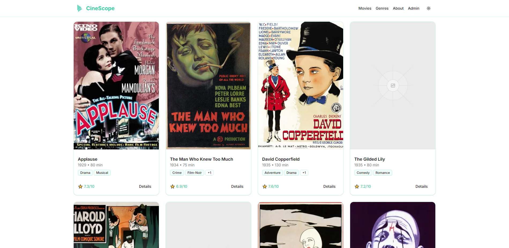

# CineScope - Movie Dashboard

CineScope is a personal web development project built with Next.js, React, and TypeScript. The project explores building a modern movie-focused dashboard with reusable components and a structured application architecture.

## Live Demo

[View CineScope](https://cinescope-olive-sigma.vercel.app/)

## Application Preview



## Overview

CineScope is a movie dashboard application developed to explore modern frontend development, component-based interfaces, and application organization.

## Tech Stack

- Next.js
- React
- TypeScript
- CSS
- Vercel (Deployment)

## Project Structure

The repository includes:

- `app/` - Application pages and routing
- `components/` - Reusable interface components
- `hooks/` - Custom React hooks
- `actions/` - Application actions
- `db/` - Database-related code
- `public/` - Static assets

## Getting Started

### 1. Clone the repository

```bash
git clone https://github.com/Dasan-Chamika/cinescope.git
```

### 2. Navigate to the directory

```bash
cd cinescope
```

### 3. Install dependencies

```bash
npm install
```

### 4. Start the development server

```bash
npm run dev
```

Open [http://localhost:3000](http://localhost:3000).

Some functionality may require environment configuration.

## Project Type

**Personal Portfolio Project**

Developed to explore modern React application development, reusable UI components, and movie dashboard interface design.

## Developer

**Dasan Chamika**

Frontend & Web Developer

[GitHub](https://github.com/Dasan-Chamika) | [LinkedIn](https://www.linkedin.com/in/dasan-chamika/)
